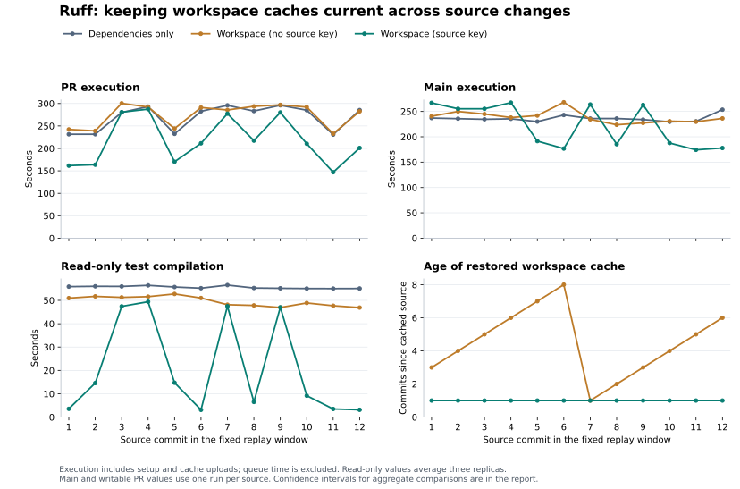

# Ruff workspace cache refresh across source commits

Compare dependency-only caches with workspace caches whose keys omit or include a source fingerprint. All saved entries are immutable; the source fingerprint lets a successful writer create a new entry after a source change.

In this replay's modeled PR workload, refreshing workspace entries saved 51.6 seconds on average compared with dependency-only caching and 57.0 seconds compared with workspace caches without a source key. Read-only test compilation fell from 49.6 to 20.8 seconds between the two workspace variants, while archive sizes and restore times remained similar. The two variants use identical pruning.

In this replay, the source-key arm uploaded twelve new entries totaling 27.75 GiB, compared with one totaling 2.31 GiB for the workspace cache without a source key. The main-job estimates include these writer costs, and their 90% intervals include no gain. The combined estimate for one PR plus its main job still favors refreshing, including the uploads. Gains vary by source change; several changes in shared `ty` code still require substantial rebuilds.

## Execution time

Each duration is averaged across source commits. Speedup divides the comparison arm's mean duration by the source-key arm's mean duration; parentheses show 90% confidence intervals for that ratio. Values below 1× indicate a slowdown.

| Workload                   | Comparison                | Comparison (s) | Source key (s) |   Speedup (90% CI) |
| -------------------------- | ------------------------- | -------------: | -------------: | -----------------: |
| PR (12 commits)            | Workspace (no source key) |          274.4 |          217.3 | 1.26× (1.18–1.36×) |
| PR (12 commits)            | Dependencies only         |          268.9 |          217.3 | 1.24× (1.16–1.34×) |
| Main (12 commits)          | Workspace (no source key) |          238.8 |          222.1 | 1.08× (1.00–1.16×) |
| Main (12 commits)          | Dependencies only         |          236.3 |          222.1 | 1.06× (0.98–1.16×) |
| One PR + main (12 commits) | Workspace (no source key) |          513.2 |          439.5 | 1.17× (1.09–1.25×) |
| One PR + main (12 commits) | Dependencies only         |          505.2 |          439.5 | 1.15× (1.07–1.24×) |

Execution time includes setup, compilation, tests, cleanup, and cache uploads. Queue time is excluded. The combined row models one PR-like run plus one main-like run per eligible source commit; a commit skipped by the PR planner contributes only its main-like run.



## Replay design

The fixed window contains twelve consecutive commits, from [`008d4526`](https://github.com/astral-sh/ruff/commit/008d4526cab4aabf974a7e32f23927e0b3449bf1) through [`7a8f63f0`](https://github.com/astral-sh/ruff/commit/7a8f63f0d71a1d381f99652a5fee3b043b32e8e6). It is the final twelve commits of the preceding thirty-commit study, selected before this replay's timings were collected. The three arms use the same source, active compiler, runner class, Cargo settings, and full job commands within each comparison.

The two full-workspace arms use identical pruning logic. The source-key arm can publish rebuilt workspace artifacts after each source change.

These are workflow-dispatch replays on an experiment branch. Each eligible source commit first receives three read-only replicas per arm. A writable producer then runs before the next source commit, saving a new entry on a miss when the cache permits. Producers also run for commits skipped by the PR planner.

The Ruff PR workflow used in this comparison does not save these caches, so the PR estimate averages the three read-only replicas for each eligible source commit. The following producer represents the main job. The separate ty annotation pass remains enabled for the same PR-like source changes in every arm.

[Depot Cache shares entries across branches](https://depot.dev/docs/cache/integrations/github-actions). Cache identities, saved archive sizes, and restored source lineage are checked for every job. Each arm has an isolated namespace. The PR-like and main-like runs use the same historical source snapshot and are serialized without competing writers or eviction between them. Initial cache population is excluded from the timing estimates.

The workspace arm without a source key and the dependency-only arm start at their last recorded key-changing producer in the previous replay. The source-key arm starts at the immediately preceding source, representing a policy that was already refreshing caches. The exact seed revisions are recorded in `metadata.json`.

| Arm                       | Initial cached source                                                                           | Age at first replayed commit (commits) |
| ------------------------- | ----------------------------------------------------------------------------------------------- | -------------------------------------: |
| Dependencies only         | [`6b161598`](https://github.com/astral-sh/ruff/commit/6b161598cd07796e178f1f8e1e422743bbd1e165) |                                      3 |
| Workspace (no source key) | [`6b161598`](https://github.com/astral-sh/ruff/commit/6b161598cd07796e178f1f8e1e422743bbd1e165) |                                      3 |
| Workspace (source key)    | [`e8b4b288`](https://github.com/astral-sh/ruff/commit/e8b4b288b489e7fc4f3c7a27e662acb115e01a0f) |                                      1 |

The paired circular moving-block bootstrap resamples the ordered commit-level observations in blocks of three, with 50,000 resamples and seed `20261025`. When several read-only replicas are selected, they are averaged within each source before bootstrapping. Main estimates and any writable PR estimates use one run per source. Replicas are not treated as independent source changes. `metadata.json` also includes block-length sensitivities of one, two, and four. These intervals resample this finite commit sequence; they do not capture all runner variability or establish performance for arbitrary future changes.

Runner: `depot-ubuntu-22.04-16`. Workflow: [`cff02f3b`](https://github.com/astral-sh/ruff/blob/cff02f3bedfbfa007629578fdc77bf1b4fcd6343/.github/workflows/ci.yaml). Existing action: [`243f4258`](https://github.com/astral-sh/github-actions/tree/243f4258608cb0f0dace8009ef4c5d8fbd3986c3/rust-workspace-cache). Refreshing action: [`7a1c709a`](https://github.com/astral-sh/github-actions/tree/7a1c709a167933c8e64f25b527696f043d5ba885/rust-workspace-cache).

The replay uses action `7a1c709a`. The downstream drafts pin [`09a77e55`](https://github.com/astral-sh/github-actions/commit/09a77e55b9cacee25c4170194cb529300c015991), which also handles tracked paths replaced by directories when a checkout is copied; the recorded Linux checkouts do not exercise that case.

## Cache costs

| Arm                       | New uploads | Uploaded (GiB) | Writer post steps (s total) | Mean read archive (MiB) |
| ------------------------- | ----------: | -------------: | --------------------------: | ----------------------: |
| Dependencies only         |           1 |           0.76 |                        12.0 |                     781 |
| Workspace (no source key) |           1 |           2.31 |                        31.0 |                    2369 |
| Workspace (source key)    |          12 |          27.75 |                       359.0 |                    2368 |

Upload totals exclude the initial seed. Writer post steps include cleanup, compression, upload, and action teardown; they are already included in execution time. Archive sizes are means across read-only replicas.

## Read-only job phases

These diagnostic replicas measure cache reuse without writes before the next producer runs.

| Phase                 | Dependencies only (s) | Workspace (no source key) (s) | Workspace (source key) (s) |
| --------------------- | --------------------: | ----------------------------: | -------------------------: |
| Rust cache restore    |                   5.8 |                          28.1 |                       28.5 |
| Main test compilation |                  55.6 |                          49.6 |                       20.8 |
| Test execution        |                  68.5 |                          68.3 |                       68.2 |
| ty annotation pass    |                  34.1 |                          34.2 |                       33.8 |
| Other job work        |                 105.0 |                          94.2 |                       66.0 |

<details>
<summary>Per-commit PR comparisons</summary>

Positive values mean the workspace cache with a source key finished sooner. The workspace comparison uses the arm without a source key.

|   # | Source                                                                                        | Change                                                                                        | Saved vs dependencies (s) | Saved vs workspace (s) |
| --: | --------------------------------------------------------------------------------------------- | --------------------------------------------------------------------------------------------- | ------------------------: | ---------------------: |
|   1 | [008d4526](https://github.com/astral-sh/ruff/commit/008d4526cab4aabf974a7e32f23927e0b3449bf1) | Update docker/build-push-action action to v7.4.0 (#29573)                                     |                      69.9 |                   80.7 |
|   2 | [9cced9ab](https://github.com/astral-sh/ruff/commit/9cced9ab2e69d4e91a29dadde291a2c4b0ba6da7) | \[`pyupgrade`\] Remove mentions of variance related to fix safety (`UP040`, `UP047`) (#29592) |                      67.9 |                   75.5 |
|   3 | [477638fb](https://github.com/astral-sh/ruff/commit/477638fb1b031dbf88c2dfcc745d6d214d40ae2b) | [ty] Compare protocol receiver restrictions before binding (#29443)                           |                      -0.6 |                   19.7 |
|   4 | [c46acee0](https://github.com/astral-sh/ruff/commit/c46acee0f9d37d2515d303bc4b1c4c500031a56e) | [ty] Refactor constraint traversal and cache satisfiability checks (#29492)                   |                       5.6 |                    4.6 |
|   5 | [6f8de53a](https://github.com/astral-sh/ruff/commit/6f8de53aa533bf3c2de2ad5e1d6987aee7c9bc72) | Prefilter bidirectional Unicode checks by UTF-8 leading bytes (#29561)                        |                      62.1 |                   73.9 |
|   6 | [acba99d5](https://github.com/astral-sh/ruff/commit/acba99d527b8a9fd2e15490df42d0e6d744a4331) | Consolidate dependency pins in root Cargo.toml (#29595)                                       |                      71.3 |                   79.7 |
|   7 | [5da3b41c](https://github.com/astral-sh/ruff/commit/5da3b41cb6a4d66f528a37318d5c571a57f989f9) | [ty] Give Self type variables distinct class identities (#29191)                              |                      18.5 |                    8.2 |
|   8 | [6f06c4a7](https://github.com/astral-sh/ruff/commit/6f06c4a7cd3754b9211f25abd5e212228d5efff7) | [ty] Remove redundant methods from the docstrings interface (#29602)                          |                      65.9 |                   76.3 |
|   9 | [3bf4988c](https://github.com/astral-sh/ruff/commit/3bf4988cf062dc76895ff2f8421acf766172392b) | [ty] Avoid widening compatible generic return alternatives (#29578)                           |                      15.9 |                   16.9 |
|  10 | [dfe14506](https://github.com/astral-sh/ruff/commit/dfe14506d23010aa5dbc4ff6fea702a22ba312bd) | [ty] Avoid cancelling requests for unrelated file changes (#29604)                            |                      74.7 |                   81.6 |
|  11 | [ab68285f](https://github.com/astral-sh/ruff/commit/ab68285f20c861bda87c0de490968eb644c426a7) | [ty] Reduce tuple class-pattern benchmark inputs (#29610)                                     |                      83.8 |                   85.8 |
|  12 | [7a8f63f0](https://github.com/astral-sh/ruff/commit/7a8f63f0d71a1d381f99652a5fee3b043b32e8e6) | [ty] Rebalance microbenchmark CI shards (#29612)                                              |                      84.4 |                   81.6 |

</details>

## Unsuccessful attempts

Execution-time estimates use successful comparison triplets. The following attempts were replaced before the next cache writer ran; all three jobs from each attempt remain in `excluded-samples.json`, including successful siblings.

| Attempt                                                                   | Source # | Dependencies only                                                                                 | Workspace (no source key)                                                                         | Workspace (source key)                                                                         |
| ------------------------------------------------------------------------- | -------: | ------------------------------------------------------------------------------------------------- | ------------------------------------------------------------------------------------------------- | ---------------------------------------------------------------------------------------------- |
| [40441497382](https://github.com/astral-sh/ruff/actions/runs/40441497382) |        9 | [cancelled, 1224.8s](https://github.com/astral-sh/ruff/actions/runs/40441497382/job/121982680494) | [cancelled, 1224.3s](https://github.com/astral-sh/ruff/actions/runs/40441497382/job/121982680454) | [success, 278.7s](https://github.com/astral-sh/ruff/actions/runs/40441497382/job/121982680562) |

Replacement reasons are recorded in `metadata.json` and `excluded-samples.json`. Failed attempts are not assigned a successful-job speedup.

Both control jobs exhausted five `GetCacheEntryDownloadURL` attempts without restoring a Rust cache, then were cancelled at the configured job limit. The source-key job passed.

## Earlier comparisons

The preceding [thirty-commit study](https://github.com/astral-sh/ruff/blob/69b9439aec48186293c2452e3e8065d50de30b88/ci-measurements/2026-10-25/README.md) compares dependency-only caches with workspace caches without source-sensitive keys. [Earlier action-migration results](earlier-comparisons.md) cover the other CI jobs and include configurations with no clear gain.

## Reproduce

`samples.csv` contains individual durations, cache lineage, source and workflow revisions, compiler and runner identities, test counts, compiled workspace packages, pruning counts, and direct job links. `step-samples.csv` retains the individual GitHub step durations. `log-hashes.json` records the SHA-256 and size of each collected runner log. `manifest.json` fixes the source history and replay settings. `excluded-samples.json` retains unsuccessful comparison attempts and their replacement reasons.

```sh
uv run --script summarize.py
uv run --script render.py
```

The standalone script independently selects PR and main samples, checks the recorded cache lineage, and recomputes all displayed comparisons and bootstrap sensitivities from the CSV. It checks its results against `metadata.json`.
